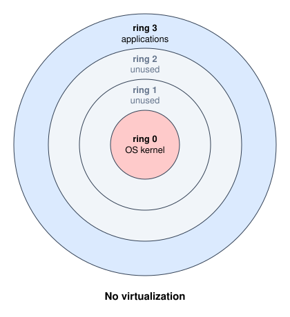
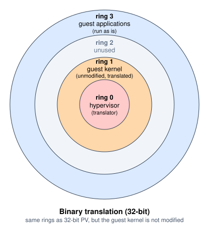
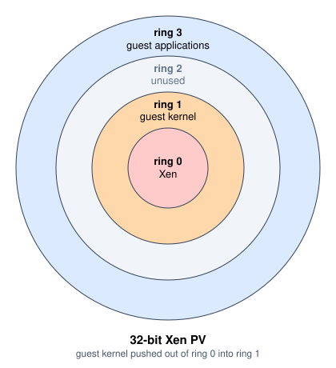
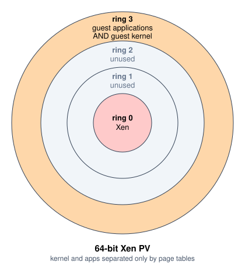
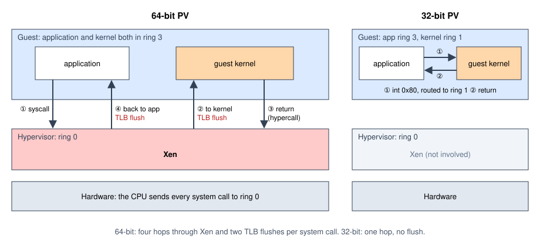
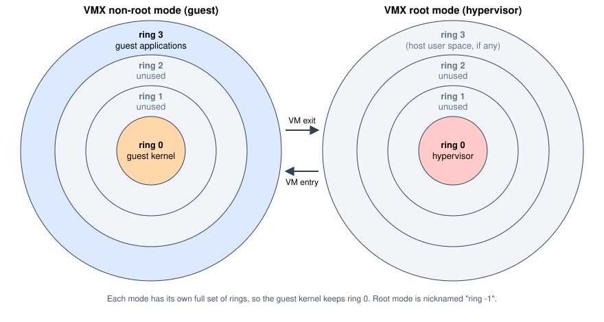
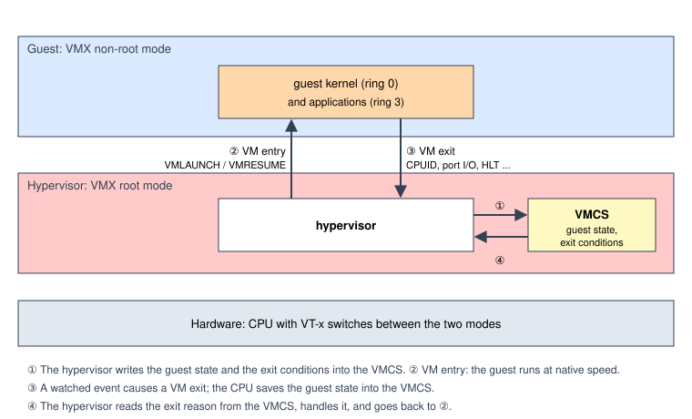

# CPU / Memory

The CPU/memory column of the [table in README.md](README.md), read from left to right: SW -> PV -> HW.

| Generation        | CPU/Memory | Privileged operations are...                             |
| ----------------- | ---------- | -------------------------------------------------------- |
| Fully emulated    | SW         | rewritten before they run (binary translation)           |
| Xen PV            | PV         | replaced with hypercalls in a modified guest kernel      |
| Xen HVM and later | HW         | trapped by the CPU (VT-x / AMD-V); memory uses EPT / NPT |

## The problem: why x86 was hard to virtualize

- Inner rings have more privilege. Only ring 0 may change page tables, disable interrupts or talk to devices.
- A hypervisor takes ring 0, so the guest kernel has to move out. The plan is for every privileged instruction the guest kernel runs to trap into the hypervisor, which then does it on the guest's behalf (trap-and-emulate).
- x86 breaks this plan: some instructions do not trap outside ring 0. For example, `POPF` silently ignores a request to disable interrupts, so the hypervisor never finds out. These are the "problem instructions" in the sections below.

## SW: binary translation (early VMware, 1998)

- The guest kernel runs in ring 1 (32-bit). Before its code runs, the hypervisor rewrites the problem instructions into calls to itself and caches the result. Guest user code runs as is.
- Memory uses shadow page tables: the guest's page tables are write-protected, every edit traps, and the hypervisor copies it into the tables the CPU really uses. `fork()`, `mmap()` and context switches get expensive.
- The guest OS needs no modification.

## PV: hypercalls (Xen, 2003)

- The guest kernel is modified: each privileged instruction becomes a hypercall, a call into Xen. A hypercall is to the hypervisor what a system call is to the kernel.
- On 32-bit, segment limits protect Xen (ring 0) from the guest kernel (ring 1).
- Memory: the guest's page tables are read-only to it. Updates go through the `mmu_update` hypercall, which Xen validates and can batch. No shadow tables.

### Why 64-bit PV got slow

- AMD64 dropped segment limits in 64-bit mode, so the guest kernel can no longer sit in ring 1. It shares ring 3 with applications, kept apart only by separate page tables.
- The CPU always sends a system call to ring 0, and ring 0 is Xen. So every system call goes through Xen on the way in and on the way out, and each switch between application and kernel changes page tables and flushes the TLB.
- 32-bit PV avoids this: `int 0x80` is routed straight to the guest kernel in ring 1.

## HW: VT-x / AMD-V and EPT/NPT (2005 onwards)

### CPU

- Two CPU modes, **VMX root** (hypervisor) and **VMX non-root** (guest), each with its own rings 0 to 3. The guest kernel keeps ring 0 and needs no modification. "Ring -1" is only a nickname for root mode.
- `POPF` and the other problem instructions now behave correctly or cause a VM exit, so the problem disappears.
- The **VMCS** (one per vCPU) holds the guest and host state and the list of events that cause an exit.

### Memory

- A guest has three kinds of address: guest virtual -> (guest page tables) -> guest physical -> (hypervisor) -> host physical, the real RAM.
- Early VT-x still used shadow page tables for the second step, so early HVM could be slower than PV on memory-heavy work.
- EPT (Intel) and NPT (AMD), from 2008, let the CPU walk both tables itself, so the guest edits its own page tables with no traps. The cost moves to TLB misses: one miss can need up to 24 memory reads instead of 4.
